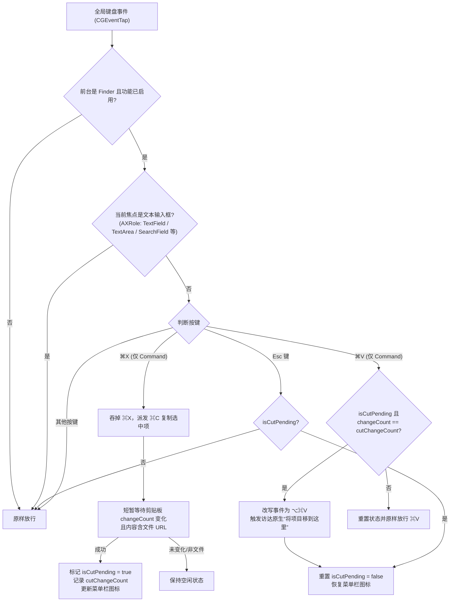

# macOS 访达（Finder）剪切工具实现方案

## 1. 项目目标

打造一个极轻量、零依赖的原生 macOS 菜单栏工具，在访达（Finder）中提供符合 Windows 习惯的 **`⌘X` 剪切 → `⌘V` 移动** 文件体验，同时不破坏系统原有的文本编辑与文件操作安全机制。

### 核心目标
- **无感体验**：在访达选中文件/文件夹按 `⌘X`，切到目标目录按 `⌘V` 即可移动，完全复用访达原生移动能力（保留进度条、同名冲突弹窗、跨盘移动及 `⌘Z` 撤销）。
- **零误触**：在访达内重命名文件、搜索框打字、或其他 App 中使用 `⌘X` / `⌘V` 时，保持系统原生文字剪切粘贴行为，绝不干扰。
- **状态可见、随时可控**：常驻菜单栏图标（不占 Dock 栏），可一眼看出当前是否处于“待移动”状态，并支持一键开关、取消剪切、开机自启与退出。
- **轻量安全**：纯原生 Swift 编写，内存占用极低，不注入访达进程，无需关闭 SIP（系统完整性保护），不联网、不记录剪贴板隐私内容。

### 非目标与系统边界
- **不支持访达文件图标变半透明**：macOS 未向第三方开放修改访达文件图标透明度的公开接口，为保证稳定与安全，不做进程注入。
- **不替代访达底层移动引擎**：文件移动仍由访达原生 `⌥⌘V`（将项目移到这里）执行，避免自写文件移动逻辑引发权限、符号链接或数据丢失风险。

---

## 2. 界面与交互设计（菜单栏形态）

应用配置为 `LSUIElement = true`（后台菜单栏应用，不出现在 Dock 栏和 `⌘Tab` 列表）：

- **菜单栏图标**（基于系统 SF Symbols）：
  - **空闲状态**：普通剪刀图标（`scissors`）。
  - **已剪切待粘贴状态**：高亮/带标记图标（如 `scissors.badge.ellipsis` 或带圆点提示），直观表明当前剪贴板中的文件处于“移动模式”。
  - **已暂停 / 缺权限状态**：置灰图标（提示用户当前未生效）。
- **下拉菜单项**：
  1. 状态栏（只读显示：`运行中` / `已剪切（按 ⌘V 移动，Esc 取消）` / `等待辅助功能权限`）
  2. 启用 / 暂停剪切功能（勾选开关）
  3. 取消当前剪切状态（仅在待粘贴状态下可点）
  4. 登录时自动启动（勾选开关）
  5. 打开“辅助功能”设置（未授权时显示，一键跳转系统设置）
  6. 退出

---

## 3. 技术方案

### 3.1 技术栈与打包方式
- **语言与框架**：原生 Swift + `AppKit` + `CoreGraphics` + `ApplicationServices` + `ServiceManagement`（无任何第三方依赖）。
- **编译与打包**：通过本机 `swiftc` 直接编译为通用或 Apple Silicon 原生二进制，组装标准 `.app` Bundle（含 `Info.plist` 和图标资源），并使用本地签名（`codesign`），方便直接拖入 `/Applications` 运行。

### 3.2 核心事件拦截与状态机



### 3.3 关键技术细节

1. **前台应用判断**
   - 通过 `NSWorkspace.shared.frontmostApplication?.bundleIdentifier == "com.apple.finder"` 判断当前是否处于访达。
2. **文本输入防误触（重点）**
   - 使用 macOS 辅助功能接口（`AXUIElementCreateSystemWide()` → `kAXFocusedUIElementAttribute`）读取当前焦点控件的 `AXRole` 与 `AXSubrole`。
   - 当焦点属于 `AXTextField`、`AXTextArea`、`AXSearchField`、`AXComboBox`、`AXWebArea` 等可编辑文本元素时，直接放行 `⌘X` / `⌘V`，确保**重命名文件、搜索栏输入、评论/标签编辑**完全不受影响。
3. **剪贴板一致性校验（防误移动）**
   - `⌘X` 触发 `⌘C` 后，记录 `NSPasteboard.general.changeCount`（系统剪贴板递增版本号）并确认剪贴板包含 `fileURL`。
   - 仅当按下 `⌘V` 时版本号仍等于 `cutChangeCount`，才把 `⌘V` 改写为 `⌥⌘V`；只要期间你在浏览器、编辑器或访达里复制了任何其他内容（哪怕按了 `⌘C`），版本号就会变，待移动标记自动失效，避免把旧文件误移动。
   - 同时可配合轻量定时检查或剪贴板变化检测，及时将菜单栏图标恢复为空闲状态。
4. **事件流防掉线**
   - 在 `CGEventTap` 回调中显式处理 `tapDisabledByTimeout` 与 `tapDisabledByUserInput`，收到后立即调用 `CGEvent.tapEnable(tap:enable:true)` 自动恢复，防止 Mac 休眠唤醒后失效。
5. **权限引导与自动激活**
   - 启动时调用 `AXIsProcessTrustedWithOptions` 检查辅助功能权限；若未授权，菜单栏显示提示并提供一键打开「系统设置 → 隐私与安全性 → 辅助功能」的入口，后台低频轮询授权状态，用户勾选后自动启用拦截，无需手动重启 App。
6. **开机自启**
   - 使用 macOS 13+ 原生 `SMAppService.mainApp` 注册登录项，开关状态与「系统设置 → 通用 → 登录项」保持同步。

---

## 4. 工程目录规划

```text
FinderCut/
├── Sources/
│   ├── main.swift              # 应用入口（NSApplication + AppDelegate）
│   ├── MenuBarController.swift # 菜单栏图标、状态展示与开关控制
│   ├── KeyInterceptor.swift    # CGEventTap 键盘拦截与 ⌘X/⌘V/Esc 状态机
│   ├── FocusInspector.swift    # AXUIElement 焦点检测（防文本输入误触）
│   └── LoginItemManager.swift  # SMAppService 开机自启封装
├── Resources/
│   └── Info.plist              # Bundle 信息（含 LSUIElement=true）
└── build.sh                    # 一键编译、打包 .app 与本地签名脚本
```

---

## 5. 验收测试清单

编码完成后，将按以下场景逐一验证：
1. **基本移动**：在访达选中单个/多个文件或文件夹，按 `⌘X` → 切到另一目录按 `⌘V`，确认文件被移动而非复制，且可用 `⌘Z` 撤销。
2. **重命名/搜索不误触**：选中文件按回车重命名，使用 `⌘X` / `⌘V` 剪切粘贴文件名文字，确认行为完全正常。
3. **中途复制自动失效**：在访达按 `⌘X` 后，去其他 App 复制一段文字（或在访达按 `⌘C` 复制另一文件），再回到访达按 `⌘V`，确认执行普通粘贴而不是移动。
4. **手动取消**：按 `⌘X` 后按 `Esc`（或点菜单栏“取消剪切”），菜单栏图标恢复空闲，再按 `⌘V` 仅为普通复制粘贴。
5. **开关与权限恢复**：暂停功能后 `⌘X` 不拦截；电脑休眠唤醒后拦截仍正常生效。

---

## 6. 动手前可确认的细节（可选）

- **App 名称**：默认可用 `FinderCut`（或你有喜欢的名字，如 `CutX`）。
- **状态反馈**：只通过菜单栏图标变化提示，还是希望按 `⌘X` 时额外弹一个半透明的轻提示（类似音量调节 HUD）？
- **安装位置**：编译打包后直接放进 `/Applications` 还是先放在当前工作目录让你试用？
